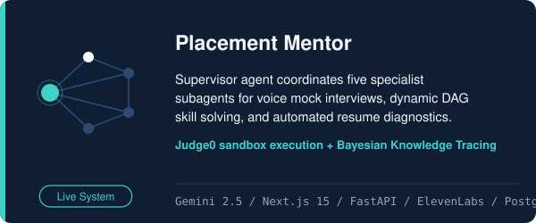
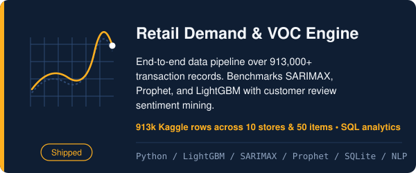
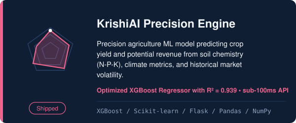
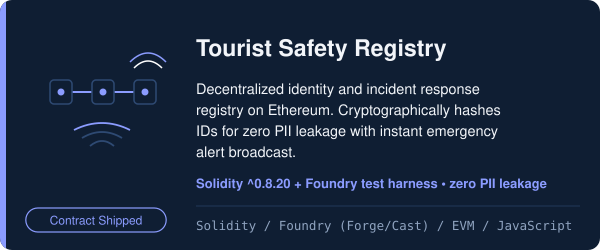
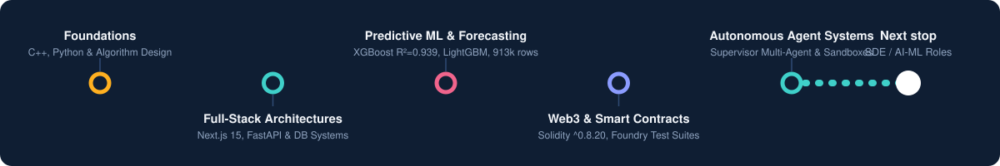
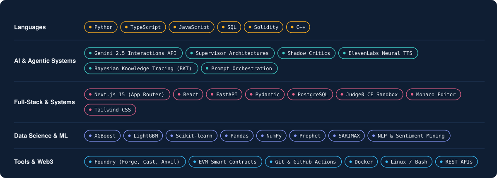

<!-- Profile README for github.com/rudecat01
     Assets live in ./assets. Regenerate them with gen.py if you change copy. -->

  

### "Hallucinated confidence isn't an engineering solution."

An LLM that evaluates code without executing it is guessing. A forecasting model that claims high accuracy without beating a naive moving-average baseline is deceiving you. That is the common thread across everything below — **Placement Mentor** doesn't trust LLMs to judge candidate solutions; it executes their code in a Judge0 sandbox while a Shadow Critic audits for hallucinations. **Retail Insight Engine** exists because fancy models often fail against simple rolling baselines unless rigorously benchmarked. And the **Tourist Safety Registry** anchors hashed identity on-chain because centralized servers remain single points of failure.

  
  
  
  

  

  

### GitHub, in numbers

  
  

  

### Let's connect

| | |
|---|---|
| **Email** | [dhruvchaudhary13978@gmail.com](mailto:dhruvchaudhary13978@gmail.com) |
| **GitHub** | [@rudecat01](https://github.com/rudecat01) |
| **LinkedIn** | [linkedin.com/in/dhruv-chaudhary](https://www.linkedin.com) *(Add your custom profile link here)* |

*Open to SDE and AI/ML engineering roles (2026–2027)*
