  

- 🤖 Architecting **Autonomous Multi-Agent Systems** with supervisor-worker patterns, shadow critique loops, and DAG skill graphs
- ⚡ Building production web services with **Next.js 15 (App Router)**, **FastAPI**, and **PostgreSQL**
- 📊 Training & benchmarking **predictive ML models** (XGBoost $R^2 = 0.939$, LightGBM, SARIMAX) against ruthless real-world baselines
- 🛡️ Writing gas-optimized, privacy-preserving smart contracts in **Solidity** tested with **Foundry**
- 🎯 Current Flagship: **[Placement Mentor](https://github.com/rudecat01/placement-mentor)** — Multi-agent career platform with Judge0 code sandboxing & ElevenLabs voice simulation

---

### 🚀 Featured Engineering Projects

<table>
  <tr>
    <td width="50%" valign="top">
      <h4>🎯 <a href="https://github.com/rudecat01/placement-mentor">Placement Mentor</a></h4>
      
<em>Autonomous Multi-Agent Career &amp; Interview Simulation Platform</em>

      <ul>
        <li><strong>Supervisor Orchestration</strong>: Central agent directs 5 specialized subagents (Roadmap Planner, Shadow Critic, Panel Interviewer, Coaching Guide, Resume Doctor).</li>
        <li><strong>Deterministic Code Sandbox</strong>: Dispatches code solutions to an isolated <strong>Judge0 CE</strong> runtime for live execution and test grading.</li>
        <li><strong>Skill DAG &amp; Mastery</strong>: Implements a <strong>Bayesian Knowledge Tracing (BKT)</strong> engine to calculate preparation load and dynamically adapt study roadmaps.</li>
        <li><strong>Neural Voice Interviews</strong>: Real-time mock technical interviews powered by ElevenLabs text-to-speech and dynamic transcript analysis.</li>
      </ul>
      

        <code>Gemini 2.5</code> &bull; <code>Next.js 15</code> &bull; <code>FastAPI</code> &bull; <code>PostgreSQL</code> &bull; <code>ElevenLabs</code> &bull; <code>Judge0</code>
      

    </td>
    <td width="50%" valign="top">
      <h4>📊 <a href="https://github.com/rudecat01/Retail-insight-engine">Retail Demand &amp; VOC Engine</a></h4>
      
<em>End-to-End Data Pipeline, Demand Forecasting &amp; Customer Analytics</em>

      <ul>
        <li><strong>Large-Scale Ingestion</strong>: Processed <strong>913,000+ daily sales records</strong> across 10 stores and 50 products into structured SQL analytical schemas.</li>
        <li><strong>Honest Model Comparison</strong>: Evaluated LightGBM, SARIMAX, and Prophet directly against naive rolling averages to measure real forecasting lift.</li>
        <li><strong>Voice of Customer (VOC)</strong>: Unsupervised review clustering, sentiment scoring, and thematic issue extraction from customer feedback streams.</li>
      </ul>
      

        <code>Python</code> &bull; <code>LightGBM</code> &bull; <code>SARIMAX</code> &bull; <code>Prophet</code> &bull; <code>SQL</code> &bull; <code>NLP Sentiment</code>
      

    </td>
  </tr>
  <tr>
    <td width="50%" valign="top">
      <h4>🌾 <a href="https://github.com/rudecat01/KrishAI">KrishiAI Precision Engine</a></h4>
      
<em>Precision Agriculture Yield &amp; Potential Revenue Prediction</em>

      <ul>
        <li><strong>Multivariate Input Analysis</strong>: Ingests soil chemical metrics (N-P-K), regional climate factors, and historical market volatility.</li>
        <li><strong>High-Precision Inference</strong>: Optimized <strong>XGBoost Regressor</strong> achieving an <strong>$R^2$ of 0.939</strong> across varied crop varieties.</li>
        <li><strong>Sub-100ms API</strong>: Lightweight Flask microservice with pre-computed regional caches for instant client dashboard evaluation.</li>
      </ul>
      

        <code>Python</code> &bull; <code>XGBoost</code> &bull; <code>Scikit-learn</code> &bull; <code>Flask</code> &bull; <code>Pandas</code> &bull; <code>NumPy</code>
      

    </td>
    <td width="50%" valign="top">
      <h4>🛡️ <a href="https://github.com/rudecat01/Tourist_safety_system_rude">Tourist Safety Registry</a></h4>
      
<em>Decentralized Identity Verification &amp; Incident Dispatch</em>

      <ul>
        <li><strong>Zero PII Leakage</strong>: Cryptographically hashes traveler identification (Aadhaar / Passport) onto the EVM to prevent plaintext data exposure.</li>
        <li><strong>Foundry Test Harness</strong>: Comprehensive unit and invariant test coverage with gas-optimized Solidity <code>^0.8.20</code> compilation.</li>
        <li><strong>Event-Driven Alerts</strong>: Instant emergency beacon emission via indexed contract events connected to a live surveillance dashboard.</li>
      </ul>
      

        <code>Solidity</code> &bull; <code>Foundry (Forge/Cast)</code> &bull; <code>Ethereum / EVM</code> &bull; <code>JavaScript</code>
      

    </td>
  </tr>
</table>

---

### 🛠️ Technical Stack

| Domain | Technologies |
| :--- | :--- |
| **Languages** | `Python` &bull; `TypeScript` &bull; `JavaScript` &bull; `SQL` &bull; `Solidity` &bull; `C++` |
| **AI & Multi-Agent** | `Google Gemini API` &bull; `Supervisor-Worker Loops` &bull; `Shadow Critics` &bull; `Judge0 Remote Sandboxing` &bull; `ElevenLabs Neural TTS` &bull; `Bayesian Knowledge Tracing` |
| **Backend & Web** | `Next.js 15 (App Router)` &bull; `FastAPI` &bull; `React` &bull; `Node.js` &bull; `Flask` &bull; `Pydantic` &bull; `PostgreSQL` &bull; `Tailwind CSS` &bull; `Monaco Editor` |
| **Data & Machine Learning** | `XGBoost` &bull; `LightGBM` &bull; `Scikit-learn` &bull; `Pandas` &bull; `NumPy` &bull; `Prophet` &bull; `SARIMAX` &bull; `NLP & Sentiment Mining` |
| **Tools & Infrastructure** | `Foundry (Forge, Cast, Anvil)` &bull; `Git & GitHub Actions` &bull; `Docker` &bull; `Linux / Bash` &bull; `REST APIs` &bull; `Postman` |

---

### 📊 Activity & Metrics

  
  &nbsp;&nbsp;
  

  

---

### 📬 Connect

- 📧 **Email**: [dhruvchaudhary13978@gmail.com](mailto:dhruvchaudhary13978@gmail.com)
- 🐙 **GitHub**: [@rudecat01](https://github.com/rudecat01)
- 💼 **LinkedIn**: [linkedin.com/in/dhruv-chaudhary](https://www.linkedin.com) *(Update with your LinkedIn URL)*

 

  Built with precision &bull; Focus on real engineering &bull; &copy; Dhruv Chaudhary

