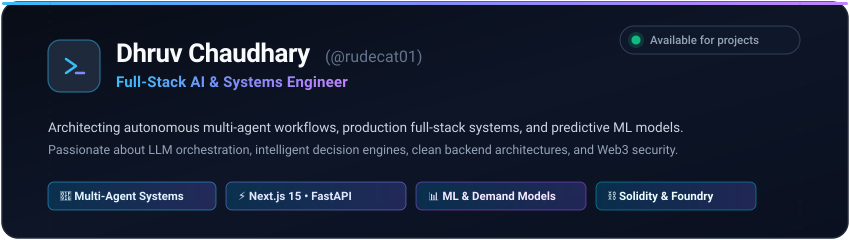

 
 

---

### 👨‍💻 About Me

I am a **Software & AI Engineer** specializing in **autonomous multi-agent workflows, full-stack systems, and production machine learning**. I build software at the intersection of intelligence and systems engineering: from multi-agent interview simulations and remote code sandboxes to large-scale retail forecasting engines and decentralized identity registries.

- 🔭 **Current Focus**: Multi-agent orchestration architectures (Supervisor-Worker patterns, shadow critique loops, and deterministic graph solvers).
- 🛠️ **Engineering Philosophy**: Real-world utility over vanity metrics. Deterministic math and robust state machines paired with LLM intelligence.
- 💬 **Ask me about**: Agentic AI workflows, Next.js 15 App Router, FastAPI backend design, model benchmarking (XGBoost / LightGBM), and EVM smart contracts.

---

### 🚀 Featured Engineering Projects

<table>
  <tr>
    <td width="50%" valign="top">
      <h4>🎯 <a href="https://github.com/rudecat01/placement-mentor">Placement Mentor</a></h4>
      
<em>Autonomous Multi-Agent Career &amp; Interview Simulation Platform</em>

      <ul>
        <li><strong>Multi-Agent Orchestration</strong>: Supervisor agent coordinating 5 specialized subagents (Roadmap Planner, Shadow Critic, Panel Interviewer, Coaching Guide, Resume Doctor).</li>
        <li><strong>Full-Stack Architecture</strong>: Next.js 15 (App Router), Monaco code editor, FastAPI, PostgreSQL, and ElevenLabs neural TTS.</li>
        <li><strong>Evaluation Engine</strong>: Remote code grading sandbox via Judge0 CE + Bayesian Knowledge Tracing (BKT) skill mastery graph.</li>
      </ul>
      

        
        
        
        
      

    </td>
    <td width="50%" valign="top">
      <h4>📊 <a href="https://github.com/rudecat01/Retail-insight-engine">Retail Demand &amp; Customer Insight Engine</a></h4>
      
<em>End-to-End Analytics, Demand Forecasting &amp; VOC Pipeline</em>

      <ul>
        <li><strong>Big Data Ingestion</strong>: Processed 913,000+ daily sales records across 10 stores and 50 items with automated SQL schema &amp; analytical views.</li>
        <li><strong>Honest Model Benchmarks</strong>: Rigorous comparison of baseline moving averages against SARIMAX, Prophet, and LightGBM regressors.</li>
        <li><strong>Voice of Customer (VOC)</strong>: Unsupervised review clustering, sentiment mining, and thematic feedback classification.</li>
      </ul>
      

        
        
        
        
      

    </td>
  </tr>
  <tr>
    <td width="50%" valign="top">
      <h4>🌾 <a href="https://github.com/rudecat01/KrishAI">KrishiAI</a></h4>
      
<em>Precision Agriculture Yield &amp; Revenue Prediction Engine</em>

      <ul>
        <li><strong>Predictive ML Pipeline</strong>: Ingests soil chemical compositions (N-P-K), climate metrics, and historical market trends.</li>
        <li><strong>High Accuracy</strong>: Optimized XGBoost Regressor achieving an <strong>R² of 0.939</strong> across multiple agricultural regions.</li>
        <li><strong>Sub-100ms Inference</strong>: Lightweight Flask backend with pre-computed lookup tables for rapid on-device evaluation.</li>
      </ul>
      

        
        
        
      

    </td>
    <td width="50%" valign="top">
      <h4>🛡️ <a href="https://github.com/rudecat01/Tourist_safety_system_rude">Tourist Safety &amp; Identity System</a></h4>
      
<em>Decentralized Identity Verification &amp; Alert Registry</em>

      <ul>
        <li><strong>Smart Contract Core</strong>: Built with Solidity &amp; Foundry framework for high gas efficiency and deterministic testing.</li>
        <li><strong>Privacy-Preserving ID</strong>: Cryptographic hashing of Aadhaar/Passport identification for verified on-chain issuance.</li>
        <li><strong>Emergency Dispatch</strong>: Event-driven incident reporting and real-time monitoring dashboard for authorities.</li>
      </ul>
      

        
        
        
      

    </td>
  </tr>
</table>

---

### 🛠️ Skills & Technologies

<table>
  <tr>
    <td align="left"><strong>Languages</strong></td>
    <td>
      <code>Python</code> • <code>TypeScript</code> • <code>JavaScript</code> • <code>SQL</code> • <code>Solidity</code> • <code>C++</code> • <code>HTML5 / CSS3</code>
    </td>
  </tr>
  <tr>
    <td align="left"><strong>AI &amp; Agent Systems</strong></td>
    <td>
      <code>Google Gemini Interactions API</code> • <code>Multi-Agent Supervisors</code> • <code>Agent Tool Use &amp; Function Calling</code> • <code>ElevenLabs TTS</code> • <code>Bayesian Knowledge Tracing (BKT)</code> • <code>Prompt Engineering</code>
    </td>
  </tr>
  <tr>
    <td align="left"><strong>Full-Stack &amp; Systems</strong></td>
    <td>
      <code>Next.js 15 (App Router)</code> • <code>React</code> • <code>FastAPI</code> • <code>Pydantic</code> • <code>Flask</code> • <code>Tailwind CSS</code> • <code>Monaco Editor</code> • <code>RESTful API Design</code>
    </td>
  </tr>
  <tr>
    <td align="left"><strong>Data Science &amp; ML</strong></td>
    <td>
      <code>XGBoost</code> • <code>LightGBM</code> • <code>Scikit-learn</code> • <code>Pandas</code> • <code>NumPy</code> • <code>Prophet</code> • <code>NLP &amp; Sentiment Analysis</code> • <code>Demand Forecasting</code>
    </td>
  </tr>
  <tr>
    <td align="left"><strong>Databases &amp; Web3</strong></td>
    <td>
      <code>PostgreSQL</code> • <code>SQLite</code> • <code>Foundry (Forge, Cast, Anvil)</code> • <code>Smart Contracts</code> • <code>EVM Architecture</code>
    </td>
  </tr>
  <tr>
    <td align="left"><strong>Tools &amp; Infrastructure</strong></td>
    <td>
      <code>Git &amp; GitHub</code> • <code>Judge0 Remote Execution</code> • <code>Linux / Bash</code> • <code>Postman</code> • <code>VS Code</code> • <code>npm / pip</code>
    </td>
  </tr>
</table>

---

### 📊 GitHub Activity & Statistics

  
  &nbsp;
  

 

  

---

### 📬 Connect With Me

- 📧 **Email**: [dhruvchaudhary13978@gmail.com](mailto:dhruvchaudhary13978@gmail.com)
- 🐙 **GitHub**: [@rudecat01](https://github.com/rudecat01)
- 💼 **LinkedIn**: [Connect on LinkedIn](https://www.linkedin.com) *(Add your custom profile link here)*

---

  Built with precision • Designed for impact • © Dhruv Chaudhary

